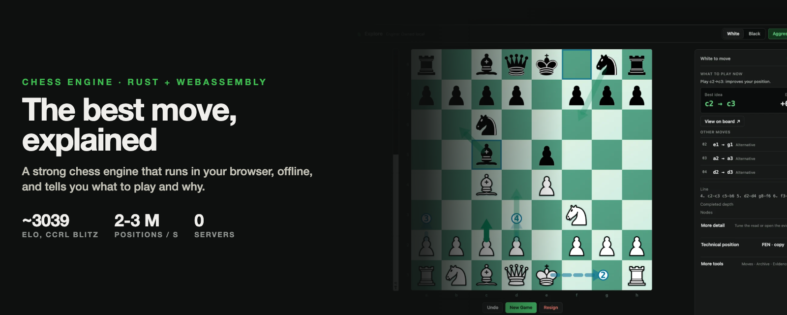
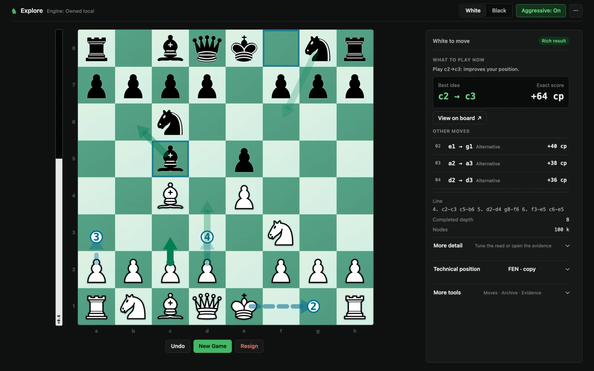
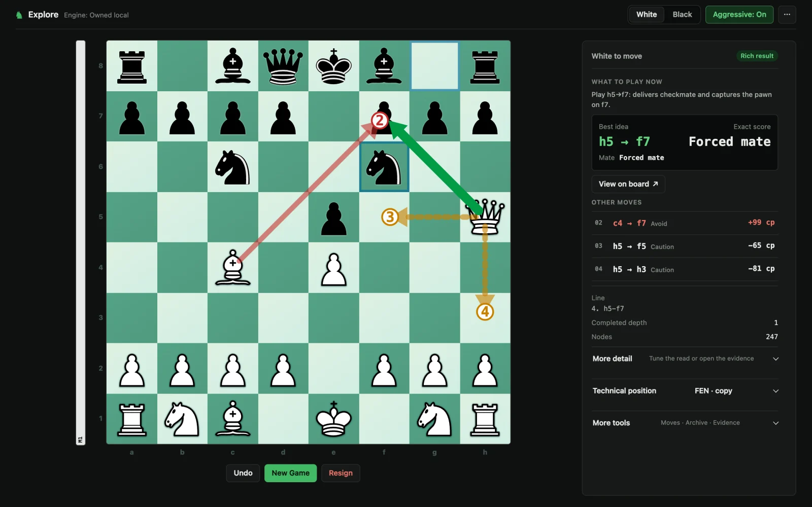
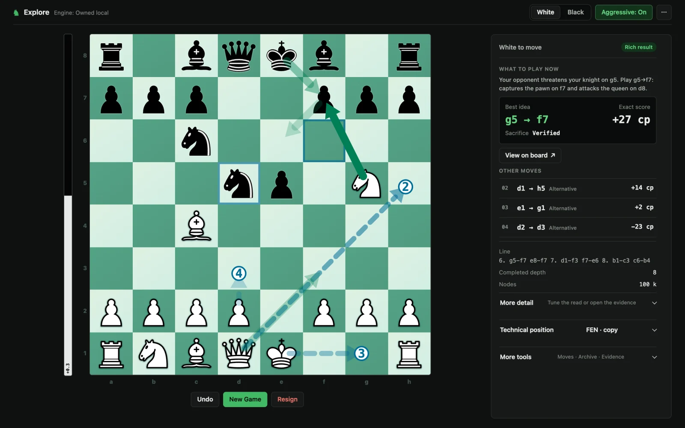
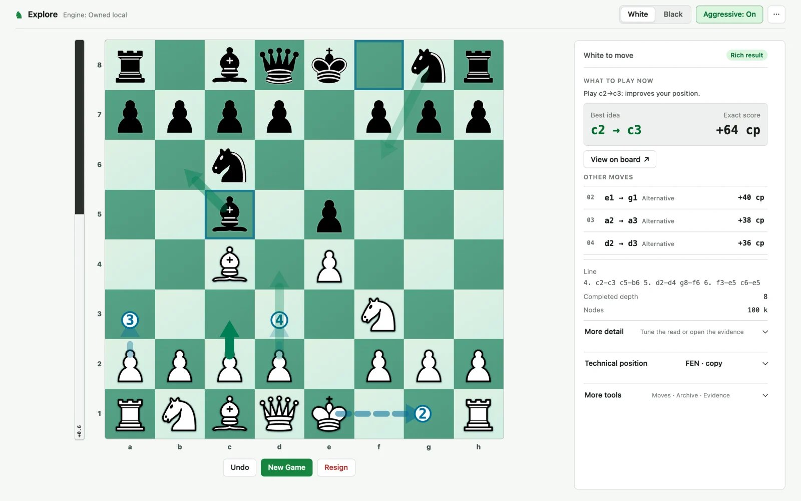
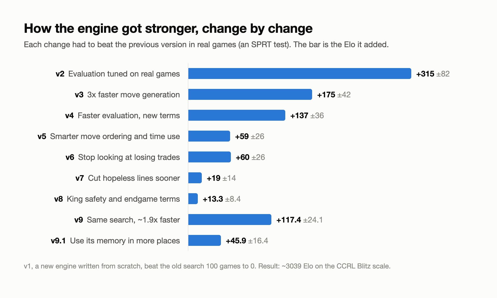
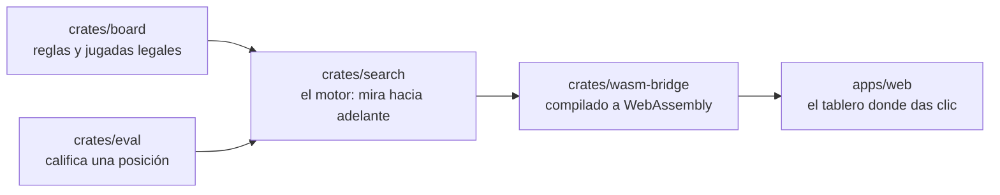

<div align="center">

<a href="https://calichess.cc"></a>

# Motor de ajedrez en tu navegador: la mejor jugada, explicada

**Un motor de ajedrez gratis que corre en tu navegador, sin internet. Abre [calichess.cc](https://calichess.cc), pon cualquier posición y te dice la mejor jugada, qué tan seguro está y por qué, en una frase sencilla. Escrito en Rust y compilado a WebAssembly.**

<a href="https://calichess.cc"></a>


[English](README.md) · **Español**

[Pruébalo](https://calichess.cc) · [Cómo se ve](#cómo-se-ve) · [En números](#en-números) · [Benchmarks](#benchmarks) · [Cómo funciona](#cómo-funciona) · [Guías](#guías)

</div>

> [!NOTE]
> **En corto:** un motor de ajedrez es un programa que imagina millones de futuros posibles de una partida, califica cada uno y elige la jugada que lleva al mejor futuro que puede comprobar. Este lo hace dentro de una pestaña del navegador, en tu propia computadora, sin servidor y sin cuenta.

## Cómo se ve

<table>
<tr>
<td width="50%"></td>
<td width="50%"></td>
</tr>
<tr>
<td align="center"><b>Qué jugar ahora</b><br><sub>La mejor jugada, su evaluación y tres alternativas en el tablero</sub></td>
<td align="center"><b>Ve el mate</b><br><sub>"Play h5→f7: delivers checkmate and captures the pawn on f7."</sub></td>
</tr>
<tr>
<td></td>
<td></td>
</tr>
<tr>
<td align="center"><b>Primero explica la amenaza</b><br><sub>"Your opponent threatens your knight on g5. Play g5→f7: captures the pawn on f7 and attacks the queen on d8."</sub></td>
<td align="center"><b>Claro u oscuro</b><br><sub>Sigue el tema de tu sistema</sub></td>
</tr>
</table>

<sub>Las capturas están en inglés; la app también habla español.</sub>

## En números

| Fuerza de juego | Posiciones revisadas por segundo | Descarga del motor | Pruebas de Rust | Llamadas a la red del motor |
|---:|---:|---:|---:|---:|
| **~3039** Elo, escala CCRL Blitz | **1.9-3.3 M** nativo, **1.0-1.5 M** en el navegador | **191 KB** comprimido | **400** pasan | **0** |

<sub>El Elo es una calificación: 100 puntos de diferencia significan que el más fuerte saca cerca del 64%. CCRL Blitz es una lista pública de calificaciones de motores; sus números no equivalen directamente al Elo FIDE de una persona.</sub>

## Benchmarks

Cada número sale de un comando que puedes volver a correr. Máquina: Mac mini M4, un hilo, commit `95bba20`, medido el 2026-11-19 y el 2026-11-20.

### Fuerza: 600 partidas contra motores calificados

El motor jugó 120 partidas contra cada una de cinco versiones de [Stash](https://gitlab.com/mhouppin/stash-bot), un motor de código abierto con calificación CCRL conocida, a 8 segundos + 0.08 s por jugada.

| Rival | Calificación CCRL del rival | Calificación que implica el resultado |
|---|---:|---:|
| Stash 21 | 2713 | 3072 |
| Stash 25 | 2932 | 3008 |
| Stash 28 | 3082 | 3059 |
| Stash 31 | 3207 | 3083 |
| Stash 34 | 3314 | 2948 |
| **Las 600 partidas** | | **~3039** (rango al 95%: 3007-3071) |

### Cómo llegó ahí

<picture>
  <source media="(prefers-color-scheme: dark)" srcset="docs/media/elo-gains-dark.png">
  
</picture>

Ningún cambio entró por corazonada. Cada uno jugó contra la versión anterior hasta que una prueba estadística (SPRT) pudo decir que era mejor; lo que no lo demostró se descartó. La lista completa, con lo que falló, está en el [caso de estudio](docs/case-study-2026-11.md#7-how-strength-was-measured) (en inglés).

### Velocidad: 5 segundos por posición

| Posición | Profundidad | Posiciones por segundo |
|---|---:|---:|
| Posición inicial | 19 | 2.28 M |
| Medio juego cerrado de d4 | 20 | 2.40 M |
| "Kiwipete" (una posición de prueba famosa por tramposa) | 20 | 1.86 M |
| Medio juego de Siciliana | 19 | 2.30 M |
| Final de alfiles | 31 | 3.34 M |
| Medio juego de Italiana | 23 | 2.74 M |

<sub>Profundidad = cuántas jugadas adelante miró (una jugada de un lado cuenta 1). Comando: `chess-cli uci`, luego `go movetime 5000` con 16 MB de hash.</sub>

En el navegador, el mismo motor corre a 1.0-1.5 M posiciones por segundo. **Explorar** da su respuesta a profundidad 9-10 en unos 0.2 s y nunca se pasa de su presupuesto de nodos.

### Jugadas correctas: perft

Perft cuenta todas las posiciones legales a pocas jugadas de distancia. Si una regla está mal (enroque, captura al paso, coronación), la cuenta no cuadra. Las dos coinciden con los valores publicados.

| Posición | Profundidad | Posiciones contadas | Tiempo | Velocidad |
|---|---:|---:|---:|---:|
| Posición inicial | 6 | 119,060,324 | 3.55 s | 33.5 M/s |
| Kiwipete | 5 | 193,690,690 | 5.63 s | 34.4 M/s |

## Cómo funciona



| Parte | Tablero | Evaluación | Búsqueda | Puente | App |
|---|---|---|---|---|---|
| Qué hace | Conoce las reglas y lista cada jugada legal, usando números de 64 bits como tableros (bitboards) | Mira una posición y regresa una calificación en centésimas de peón | Explora jugadas futuras, se salta líneas que no importan y recuerda posiciones que ya vio | Convierte el motor de Rust en un archivo que el navegador puede correr | Dibuja el tablero, corre el motor en un hilo aparte y escribe la explicación |
| Dónde | [`crates/board`](crates/board) | [`crates/eval`](crates/eval) | [`crates/search`](crates/search) | [`crates/wasm-bridge`](crates/wasm-bridge) | [`apps/web`](apps/web) |

> [!IMPORTANT]
> Tus jugadas nunca salen de tu navegador. El motor y la app no hacen llamadas a la red por su cuenta, y una revisión dentro de `just check` falla si aparece una. El sitio público calichess.cc cuenta visitas con Cloudflare Web Analytics, que no usa cookies.

## Guías

| Úsalo | [Encuentra la mejor jugada en cualquier posición](https://calichess.cc/guides/es/mejor-jugada-ajedrez) |
|---|---|
| **Aprende** | [Cómo funciona un motor de ajedrez, explicado fácil](https://calichess.cc/guides/es/como-funciona-un-motor-de-ajedrez) |
| **Cómo se hizo** | [Un motor de 3000 Elo en Rust y WebAssembly](https://calichess.cc/guides/es/motor-de-ajedrez-rust-webassembly-3000-elo) |

## Correrlo en local

Necesitas Rust (estable), Node 22 o 24, pnpm y [`just`](https://github.com/casey/just).

```sh
pnpm install
just preview   # compila el motor a WebAssembly y sirve la app en http://127.0.0.1:7700
```

<details>
<summary><b>Pruebas, revisiones y el motor como programa UCI</b></summary>

```sh
just test      # pruebas de Rust y de la web
just check     # formato, lints, licencias, auditoría de red, typecheck
just site-deploy   # arma calichess.cc (app + guías + sitemap) y lo publica en Cloudflare Pages

cargo build --release -p chess-cli
target/release/chess-cli uci                                     # conéctalo a cualquier interfaz UCI de ajedrez
target/release/chess-cli perft --fen "<FEN>" --depth 5           # cuenta posiciones legales
```

</details>

## Para leer más

[Caso de estudio: reconstruir el motor en 36 horas](docs/case-study-2026-11.md) (en inglés), con cada commit, prueba y número detrás de esta página, y lo que no funcionó.

---

<sub>Licencia MIT. Stockfish y Stash solo se usan en la máquina del autor para medir la fuerza; no forman parte de este programa.</sub>
