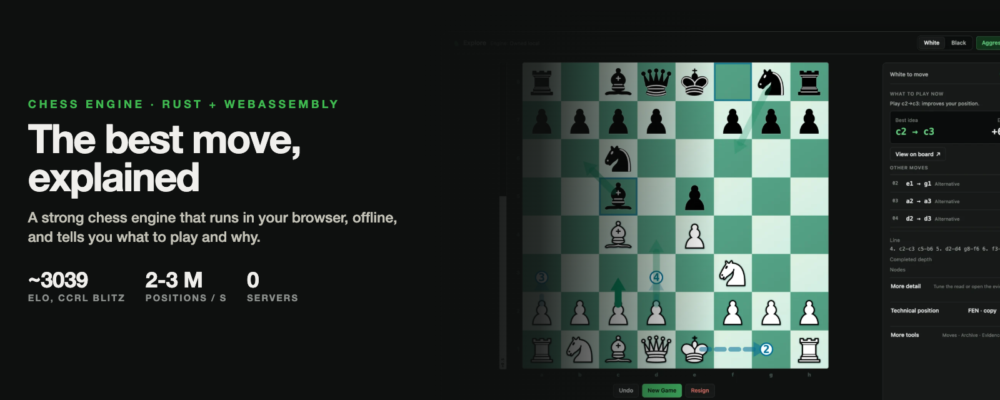
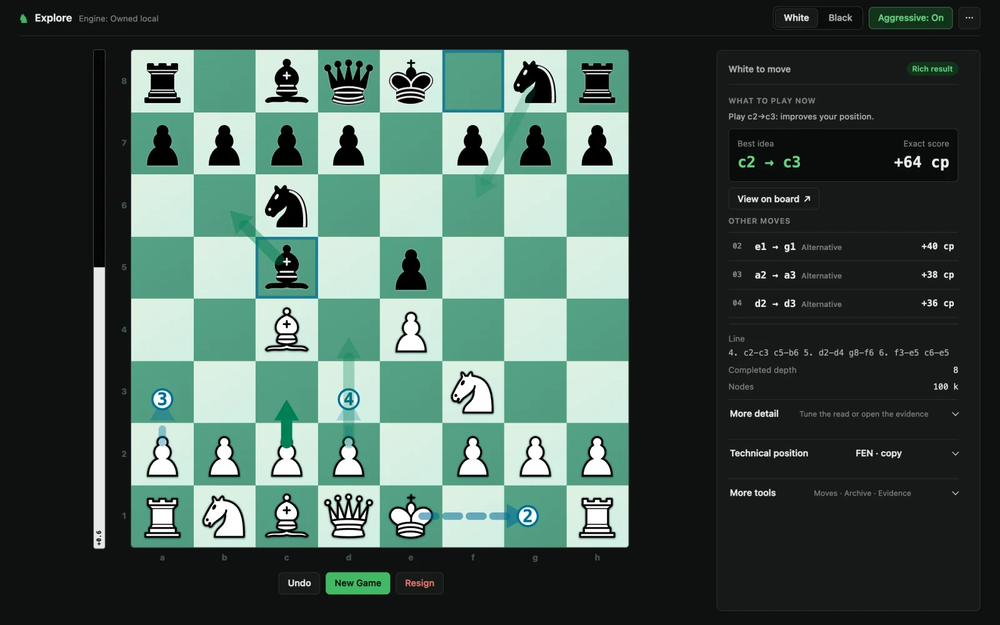
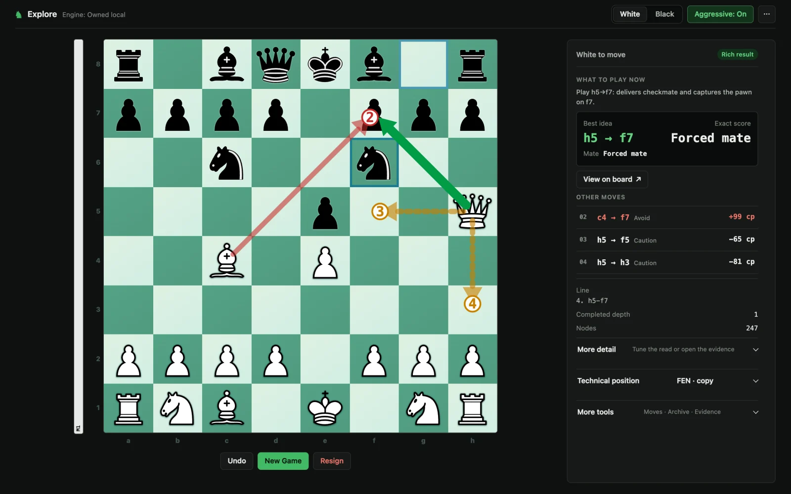
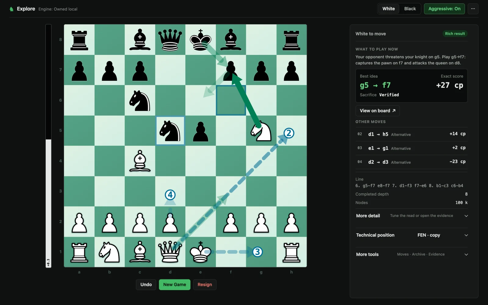
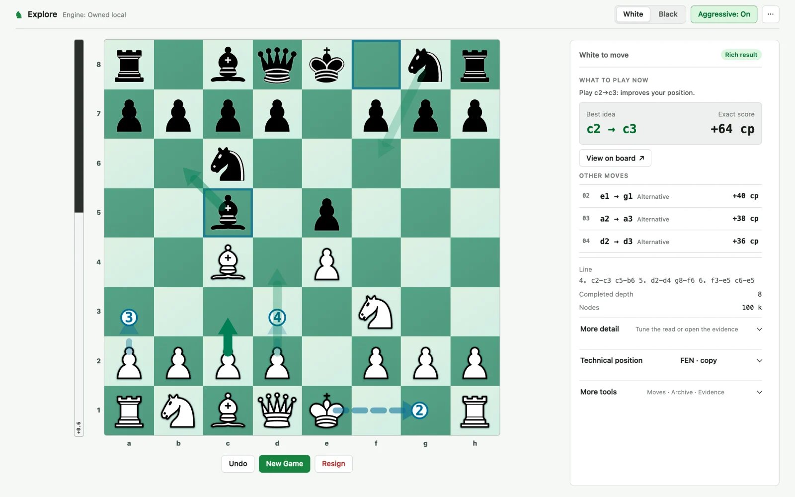
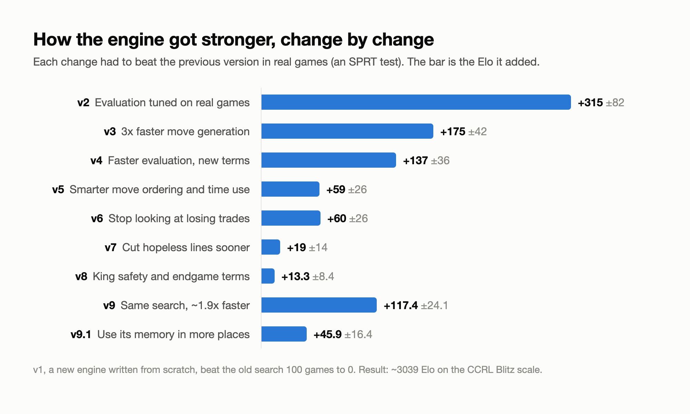
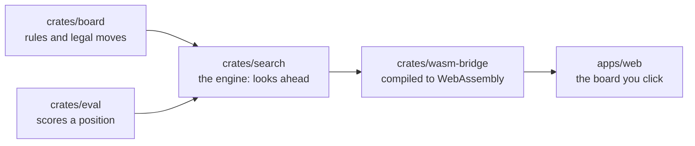

<div align="center">

<a href="https://calichess.cc">

# Chess engine in your browser: the best move, explained

**A free chess engine that runs in your browser, offline. Open [calichess.cc](https://calichess.cc), set up any position, and it tells you the best move, how sure it is, and why, in one plain sentence. Written in Rust, compiled to WebAssembly.**

<a href="https://calichess.cc"></a>


**English** · [Español](README.es.md)

[Try it](https://calichess.cc) · [What it looks like](#what-it-looks-like) · [In numbers](#in-numbers) · [Benchmarks](#benchmarks) · [How it works](#how-it-works) · [Guides](#guides)

</div>

> [!NOTE]
> **In one breath:** a chess engine is a program that imagines millions of possible futures of a game, scores each one, and picks the move that leads to the best future it can prove. This one does that inside a browser tab, on your own computer, with no server and no account.

## What it looks like

<table>
<tr>
<td width="50%"></td>
<td width="50%"></td>
</tr>
<tr>
<td align="center"><b>What to play now</b><br><sub>The best move, its score, and three alternatives drawn on the board</sub></td>
<td align="center"><b>It sees mate</b><br><sub>"Play h5→f7: delivers checkmate and captures the pawn on f7."</sub></td>
</tr>
<tr>
<td></td>
<td></td>
</tr>
<tr>
<td align="center"><b>It explains the threat first</b><br><sub>"Your opponent threatens your knight on g5. Play g5→f7: captures the pawn on f7 and attacks the queen on d8."</sub></td>
<td align="center"><b>Light or dark</b><br><sub>Follows your system theme</sub></td>
</tr>
</table>

## In numbers

| Playing strength | Positions searched per second | Engine download | Rust tests | Network calls by the engine |
|---:|---:|---:|---:|---:|
| **~3039** Elo, CCRL Blitz scale | **1.9-3.3 M** native, **1.0-1.5 M** in the browser | **191 KB** gzipped | **400** passing | **0** |

<sub>Elo is a rating: a 100-point gap means the stronger side scores about 64%. CCRL Blitz is a public rating list for engines; its numbers do not map directly to human FIDE ratings.</sub>

## Benchmarks

Every number below comes from a command you can run again. Machine: Mac mini M4, one thread, commit `95bba20`, measured 2026-11-19 and 2026-11-20.

### Strength: 600 games against rated engines

The engine played 120 games against each of five versions of [Stash](https://gitlab.com/mhouppin/stash-bot), an open-source engine with known CCRL ratings, at 8 seconds + 0.08 s per move.

| Opponent | Opponent's CCRL rating | Rating this result implies |
|---|---:|---:|
| Stash 21 | 2713 | 3072 |
| Stash 25 | 2932 | 3008 |
| Stash 28 | 3082 | 3059 |
| Stash 31 | 3207 | 3083 |
| Stash 34 | 3314 | 2948 |
| **All 600 games** | | **~3039** (95% range 3007-3071) |

### How it got there

<picture>
  <source media="(prefers-color-scheme: dark)" srcset="docs/media/elo-gains-dark.png">
  
</picture>

No change got in on a hunch. Each one played the previous version until a statistical test (SPRT) could say it was better; changes that could not prove it were thrown out. The full list, including what failed, is in the [case study](docs/case-study-2026-11.md#7-how-strength-was-measured).

### Speed: 5 seconds per position

| Position | Depth reached | Positions per second |
|---|---:|---:|
| Starting position | 19 | 2.28 M |
| Closed d4 middlegame | 20 | 2.40 M |
| "Kiwipete" (a famously tricky test position) | 20 | 1.86 M |
| Sicilian middlegame | 19 | 2.30 M |
| Bishop endgame | 31 | 3.34 M |
| Italian middlegame | 23 | 2.74 M |

<sub>Depth = how many moves ahead it looked (one move by one side counts as 1). Command: `chess-cli uci`, then `go movetime 5000` with 16 MB hash.</sub>

In the browser, the same engine runs at 1.0-1.5 M positions per second. **Explore** gives its answer at depth 9-10 in about 0.2 s, and never goes over its node budget.

### Correct moves: perft

Perft counts every legal position a few moves deep. If one rule is wrong (castling, en passant, promotion), the count is off. Both match the published values.

| Position | Depth | Positions counted | Time | Speed |
|---|---:|---:|---:|---:|
| Starting position | 6 | 119,060,324 | 3.55 s | 33.5 M/s |
| Kiwipete | 5 | 193,690,690 | 5.63 s | 34.4 M/s |

## How it works



| Part | Board | Evaluation | Search | Bridge | App |
|---|---|---|---|---|---|
| What it does | Knows the rules and lists every legal move, using 64-bit numbers as boards (bitboards) | Looks at a position and returns a score in hundredths of a pawn | Explores future moves, skips lines that cannot matter, remembers positions it has seen | Turns the Rust engine into a file a browser can run | Draws the board, runs the engine in a background thread, writes the explanation |
| Where | [`crates/board`](crates/board) | [`crates/eval`](crates/eval) | [`crates/search`](crates/search) | [`crates/wasm-bridge`](crates/wasm-bridge) | [`apps/web`](apps/web) |

> [!IMPORTANT]
> Your moves never leave your browser. The engine and the app make no network calls of their own, and a check in `just check` fails the build if one appears. The public site at calichess.cc counts visits with Cloudflare Web Analytics, which uses no cookies.

## Guides

| Use it | [Find the best move in any position](https://calichess.cc/guides/en/best-chess-move-finder) |
|---|---|
| **Learn** | [How a chess engine works, explained simply](https://calichess.cc/guides/en/how-a-chess-engine-works) |
| **How it was made** | [Building a 3000 Elo engine in Rust and WebAssembly](https://calichess.cc/guides/en/rust-webassembly-chess-engine-3000-elo) |

## Run it locally

You need Rust (stable), Node 22 or 24, pnpm and [`just`](https://github.com/casey/just).

```sh
pnpm install
just preview   # builds the engine to WebAssembly and serves the app at http://127.0.0.1:7700
```

<details>
<summary><b>Tests, checks and the engine as a UCI program</b></summary>

```sh
just test      # Rust and web tests
just check     # format, lints, licenses, no-network audit, typecheck
just site-deploy   # build calichess.cc (app + guides + sitemap) and publish it to Cloudflare Pages

cargo build --release -p chess-cli
target/release/chess-cli uci                                     # plug into any UCI chess GUI
target/release/chess-cli perft --fen "<FEN>" --depth 5           # count legal positions
```

</details>

## Read more

[Case study: rebuilding the engine in 36 hours](docs/case-study-2026-11.md), with every commit, test and number behind this page, and what did not work.

---

<sub>MIT licensed. Stockfish and Stash are used only on the author's machine to measure strength; they are not part of this program.</sub>
