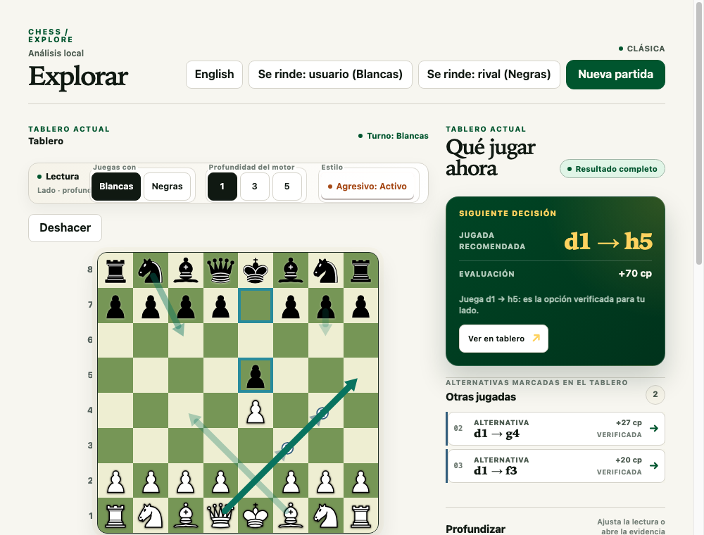

# Case study: rebuilding a chess engine in 36 hours (November 2026)

**Chess** is a chess engine and analysis app written in Rust and TypeScript. It runs entirely on the
user's machine and in the web browser through WebAssembly, with no network access. Between
18 and 20 November 2026 the project went through a large refactor: 63 commits, 1,193 files touched,
13,540 lines added and 157,518 lines removed. In that window a new playing engine was written from
scratch and measured at roughly **3039 Elo on the CCRL Blitz scale**. The repository shrank from
1,355 tracked files to 265. The engine moved into the browser, and the main analysis view,
*Explore*, was rebuilt on top of it.

This document is a forensic audit of that work. Every number cites the commit or the command that
produced it, and each section opens with a plain-language summary before the technical detail.

| | Before | After (`4bcee2a`, 2026-11-20) |
|---|---|---|
| Tracked files | 1,355 | 265 |
| Lines in the tree | 294,575 | 120,662 |
| Playing strength | ~1286 Elo on Stockfish's limited-strength scale (1215-1348, 32 games, 18 Nov); the old search lost **100-0** to the first version of the new engine | **~3039 CCRL Blitz** (95% CI 3007-3071) |
| Native search speed | legacy search ~120 k nodes/s (`bb57ff0`) | engine 2.0-3.0 M nodes/s |
| Explore in the browser | depth 1-5, 220-290 k nodes/s, overran its node budget | depth 9-10 in ~200 ms, 1.0-1.5 M nodes/s, exact budget |
| Explore after 1.e4 e5 (Aggressive) | 3.Qh5 (+70), a beginner's move | 3.d4 (+52) |
| Rust tests | not re-run | 400 passing, 0 failing (re-run for this report) |

*Before* means `76ea4f4` (2026-10-04) for file and line counts, and the old code's last measurement
for speed and Explore.

---

## Contents

1. [Background: what a chess engine is](#1-background-what-a-chess-engine-is)
2. [Timeline](#2-timeline)
3. [Clearing the ground](#3-clearing-the-ground)
4. [A faster board](#4-a-faster-board)
5. [Removing the neural network](#5-removing-the-neural-network)
6. [A new engine](#6-a-new-engine)
7. [How strength was measured](#7-how-strength-was-measured)
8. [The speed milestone](#8-the-speed-milestone)
9. [The engine in the browser](#9-the-engine-in-the-browser)
10. [Explore on the real engine](#10-explore-on-the-real-engine)
11. [Interface](#11-interface)
12. [What did not work](#12-what-did-not-work)
13. [Verification for this report](#13-verification-for-this-report)
14. [Known gaps](#14-known-gaps)
15. [How I did it](#15-how-i-did-it)
16. [Glossary](#16-glossary)

---

## 1. Background: what a chess engine is

> **In short:** a chess engine imagines many possible futures of a game, scores each one, and picks
> the move that leads to the best future it can prove.

A **chess engine** is a program that chooses chess moves. It has three parts. The *board* knows the
rules and lists the legal moves. The *evaluation* looks at a position and returns a score in
centipawns (hundredths of a pawn). The *search* explores the tree of future moves and backs those
scores up to the present position.

Engines are compared by **Elo**, a rating where a 100-point gap means the stronger side scores about
64%. **CCRL** (Computer Chess Rating Lists) is a public list that rates engines by playing them
against each other. A rating "on the CCRL scale" means the engine was measured against opponents
whose CCRL ratings are known. It is not an official CCRL entry.

Raw speed is measured in **nodes per second** (nps), the number of positions the search visits each
second. Speed, accuracy and strength are three different things. A faster engine is only stronger
if it searches the same tree, and a more accurate evaluation is only better if it wins games.

This project's architecture:

```text
board -> eval (tapered, Texel-tuned) -> search (engine.rs -> explore.rs)
      -> wasm-bridge -> browser worker -> UI
```

## 2. Timeline

All times are local (UTC-6). The window runs from `9e85e80` (18 Nov, 13:05) to `4bcee2a`
(20 Nov, 01:08), about 36 hours.

| When | Block | Key commits | Outcome |
|---|---|---|---|
| 18 Nov 13:05 | Ground clearing | `9e85e80`, `e6bf859` | 1,087 files and 132,956 lines of process documents archived to a git tag |
| 18 Nov 15:11-18:45 | Board and old-search speed | `a161f6d`, `bb57ff0`, `9d8aea8`, `6bcaf22` | Bitboard attacks, legal moves once per node, old search 120 k → 196 k nps |
| 18 Nov 21:01-21:15 | Repository polish | `37e6aae`, `7adbeda` | MIT license, README with measured numbers, personal paths removed |
| 18 Nov 23:51 | NNUE removal | `bf44810`..`c0b68b0` | Neural evaluation deleted; output byte-identical |
| 19 Nov 00:45-04:45 | New engine and Elo | `9f57938`..`1bd8a04` | New PVS engine, seven versions, each gated by a statistical test |
| 19 Nov 11:36-11:48 | Browser engine | `ff95e6b`, `47586be` | Browser opponent plays the real engine at levels 1-6 |
| 19 Nov 13:26-16:13 | Evaluation | `320ed02`, `c3e329e` | New evaluation terms, +13.3 Elo (v8) |
| 19 Nov 18:31-19:34 | Speed milestone | `ce31a8e`, `75e4b6a`, `463d727` | Same tree at ~1.9x nps; v9 ≈ 3039 CCRL |
| 19 Nov 21:31-23:37 | Audit | `92fa81e`, `e823ecb`, `3734204` | UCI bug fixed, README claims corrected, empty crates removed |
| 20 Nov 00:10 | Explore migration | `29c09ff` | Explore runs on the engine; 15,702 lines deleted |
| 20 Nov 01:08 | Explore redesign | `4bcee2a` | New panel, evaluation bar, generated explanation sentence |

## 3. Clearing the ground

> **In short:** the project had more paperwork than code. The paperwork was boxed up and put on a
> shelf where it can still be found, and replaced by a one-page map.

Before the refactor, the repository held a large governance corpus: architecture decision records
(ADRs), approvals, handoffs, audits and plans. Commit `9e85e80` moved 1,087 of those files
(132,956 lines) out of the working tree. They remain reachable through the git tag
`governance-archive`. The chain of rule documents (`PLANS.md` alone was 1,150 lines) was replaced by a 76-line `AGENTS.md` that states
the goals, maps the code with `file:line` references, and lists known findings and commands.

A smaller rule came with it: one dependency approval (`wasm-bindgen`) that used to require an ADR
file is now recorded in code, where the build checks it.

## 4. A faster board

> **In short:** the board used to check every square one by one. It now uses *bitboards*, 64-bit
> numbers where each bit is a square, so the computer can answer "is this square attacked?" with a
> few arithmetic operations.

Four commits on 18 November made the board and the old search faster without changing their output:

- **`a161f6d` Cheaper legality checks.** Only king moves, en passant, pinned-line moves and moves made
  while in check are verified on a scratch position. The rest are legal by construction.
- **`bb57ff0` Legal moves once per node.** Mate and stalemate are derived from the node's own move
  list, and quiescence reuses it. The tree is unchanged (53,153 nodes before and after) and speed
  rose from 120 k to 196 k nps.
- **`9d8aea8` Bitboard attack detection.** Per-colour and per-piece occupancy bitboards, constant
  attack tables for knights, kings and pawns, and ray attacks for sliders. A test compares all
  128 attack queries in six positions against the old mailbox code. Speed rose from ~279 k to
  ~420 k nps at the same 462,986 nodes.
- **`6bcaf22` Explore as one MultiPV search.** Several separate passes were replaced by one shared
  search, removing 609 lines.

Move generation is checked with **perft**, which counts every legal position to a given depth and
compares the total with known values. From the start position at depth 5 the answer must be
4,865,609. It still is, in 0.14 s.

## 5. Removing the neural network

> **In short:** an experimental neural-network evaluator was switched off for good and its code was
> deleted. The engine plays exactly the same moves without it.

**NNUE** (efficiently updatable neural network) is the evaluation style used by modern top engines.
The project had an experimental NNUE path. On 18 November the owner retired it permanently, and
four commits (`bf44810`, `903d828`, `a77e63a`, `c0b68b0`) removed the web toggle, the WASM
exports, the CLI flag, the `Evaluator` type and the evaluator itself.

The proof that nothing else changed: a 30-line CLI fingerprint diff came back empty, and a
fixed benchmark still visited exactly 53,996 nodes (`a77e63a`).

## 6. A new engine

> **In short:** the old search was replaced by a new one built from well-known techniques. The
> first version won all 100 of its games against the old one.

Commit `9f57938` added `crates/search/src/engine.rs`, a new playing engine, plus a UCI mode and a
new evaluation. **UCI** (Universal Chess Interface) is the text protocol that lets engines play in
tournaments and GUIs.

The search is **principal variation search (PVS)**, a refinement of alpha-beta search that searches
the expected best move with a full window and the others with a narrow, cheaper one. Around it are
the standard techniques of modern engines:

| Technique | Plain meaning |
|---|---|
| Transposition table (TT) | Remembers positions already searched, reached by different move orders |
| Null-move pruning | "If I skip my turn and I'm still winning, this line is good enough to cut" |
| Late move reductions (LMR) | Moves sorted late are probably bad, so search them shallower first |
| Reverse futility, futility, late move pruning | Skip moves that cannot plausibly change the result |
| Quiescence search with SEE | At the end of a line, keep resolving captures so the score isn't taken mid-exchange |
| Killers, history, capture and continuation history | Learn which moves caused cutoffs and try them earlier |
| Aspiration windows, check extension, IIR | Narrow first guesses, search checks deeper, reduce nodes with no stored best move |

The evaluation (`crates/eval/src/tapered.rs`) is **tapered**: every term has a middlegame and an
endgame value, blended by how much material is left. Its weights were fitted with **Texel tuning**,
which adjusts the weights so the evaluation predicts game results on millions of quiet positions.
The first fit used 2.2 M positions from Lichess games (held-out error 0.05899 → 0.05657).

Later evaluation commits added threats, king safety, passed pawns, outposts and mobility
(`039c068`, error → 0.05399). They also added pawn shelter and storm, backward pawns, bishop and
minor-piece terms, and an endgame scale factor (`c3e329e`).

Two commits made the engine fast before it was made smart: pseudo-legal move generation
(`39d0bf2`, start position ~370 k → ~1.1 M nps) and a bitboard evaluation with identical values
(`070826b`, ~3-4x evaluations per second).

## 7. How strength was measured

> **In short:** every change had to win a long, fair match against the previous version before it
> was kept. When a change that should have helped lost badly, the cause turned out to be a bug,
> not bad luck.

Each candidate played the previous version in a **sequential probability ratio test (SPRT)**. The
test keeps playing games until it can say with set confidence that the change gains Elo, or that
it doesn't. Matches ran in `fastchess` at 5+0.05 (5 s per game plus 0.05 s per move), and later
used balanced *UHO* openings and 10 cores. The test bench lives outside the repository
(`~/chess-elo`), so these runs cannot be replayed from this repo alone.

| Version | Commit | Change | Result |
|---|---|---|---|
| v1 | `9f57938` | New PVS engine, classical eval | 100-0 vs the old search |
| v2 | `9f57938` | Tapered Texel eval | +315 ± 82 vs v1 (100 games) |
| v3 | `39d0bf2` | Pseudo-legal movegen, ~3x nps | +175 ± 42, LLR 2.97 |
| v4 | `070826b`, `039c068` | Bitboard eval + new terms | +137 ± 36, LLR 2.96 |
| v5 | `a7060ec`, `89982e0`, `5c1f65a` | IIR, capture/continuation history, time by stability | +59 ± 26, LLR 2.97 |
| v6 | `8cddd11` | SEE pruning with `see()` fixed | +60 ± 26, LLR 2.97 |
| v7 | `1bd8a04` | "Improving" flag in RFP, LMP, LMR | +19 ± 14, LLR 2.95 (1,114 games) |
| v8 | `c3e329e` | Ethereal-style eval terms, endgame scale | +13.3 ± 8.4, LLR 2.95 (3,262 games) |
| v9-speed1 | `ce31a8e` | Same tree, ~1.9x nps | +117.4 ± 24.1, LLR 2.95 |
| v9-tt1 | `463d727` | TT cutoffs inside null-move branches | +45.9 ± 16.4, LLR 2.96 |

**The `see()` bug.** *Static exchange evaluation* (SEE) predicts the outcome of a sequence of
captures on one square. Adding SEE pruning at first *cost* about 80 Elo, which made no sense for a
standard technique. Bisecting the change found the cause: `see()` skipped the last recapture when
folding gains back, so a queen taking a pawn defended by a pawn scored +100 instead of −800. With
the fix (`8cddd11`) the same pruning gained +60. Since then, a standard technique that loses a lot
is treated as a bug report before it is treated as a tuning result.

**Anchoring to CCRL.** Self-play only measures gains relative to the previous version. To get an
absolute number, the engine played gauntlets against engines with known CCRL ratings, at 8+0.08.
An early estimate for v7 was ~2830. The audit on 19 November found the anchors were too weak to
measure that. With a ladder of Stash 21-34 (CCRL 2713-3314, all hand-crafted evaluations like
this one), v8 measured **~2917** (95% CI 2884-2950). After the speed milestone, v9 measured
**~3039** (95% CI 3007-3071, gauntlet G05). A 100-game check of v7 at the slower 20+0.2 time
control scored better than at 8+0.08, so the fast time control was not inflating the number.

## 8. The speed milestone

> **In short:** the engine was made almost twice as fast without changing a single move it
> considers. Same thinking, less time. That alone was worth about 117 Elo.

An audit of v8 found that speed, not evaluation, was the ceiling: v8 ran at 1.0-1.45 M nps while
comparable anchors ran at 3.6-8.8 M. The milestone set two targets, 2x native speed and 3000 CCRL,
and closed the same day.

Commit `ce31a8e` is the core. A fixed-depth benchmark (six positions, depth 15) visits exactly
**6,891,892 nodes** before and after, which proves the search is unchanged. The changes:

- Prune (futility, LMP, SEE, delta) *before* making the move, using an exact bitboard
  `gives_check`.
- Reuse per-ply move buffers instead of initialising ~5 KB of lists per node.
- Select moves on packed score/index keys.
- Cache the static evaluation and the pawn-and-king term.

Result: 2.38 M vs 1.28 M nps on the speed script (1.85x, 1.97x at fixed depth). Then `463d727`
allowed transposition-table cutoffs inside null-move branches (+45.9 Elo), giving the final
**~3039 CCRL**.

## 9. The engine in the browser

> **In short:** the opponent you play in the browser used to be a weaker, separate program. Now it
> is the real engine, with six strength levels.

Commit `ff95e6b` exports `engine_move_json` from the WASM bridge. It runs the persistent engine
through `skill::think_at_level`. Levels 1-5 pick among root moves by a softmax over shallow scores,
and level 6 is the full engine capped at 1 M nodes (about 1-2 s in the browser). Level 5 was
measured at ~2250 on Stockfish's `UCI_Elo` scale (120 games, v7-era engine). The other levels were
not measured individually.

Commit `92fa81e` fixed a UCI correctness bug. An invalid `position` command used to leave the
previous position in place silently. It is now rejected, and the web engine resets on every new
game.

## 10. Explore on the real engine

> **In short:** *Explore* is the view that tells you what to play next. It was still running the old
> search, which could only look a few moves ahead. It now asks the real engine for its four best
> moves.

Until 20 November, Explore used the legacy search in `crates/search/src/lib.rs`. In the browser it
reached depth 1-5 at 220-290 k nps and overran its node budget. After 1.e4 e5 in Aggressive mode it
recommended 3.Qh5 (+70), which strong engines rate worse than developing a knight.

Commit `29c09ff` changed this:

- `engine.rs` gained **MultiPV** (`think_multi`), which returns the best *N* lines by excluding
  root moves already found. Single-line search is unchanged (same node count at depth 11 on the
  Kiwipete test position).
- `explore.rs` builds Explore on four engine lines. *Aggressive* mode no longer has its own search.
  It only reorders candidates within 50 centipawns of the best one, ranked by pressure on the
  enemy king after three plies. Aggressive never trades soundness for style.
- The old Explore search, its gates and its style evaluation were deleted. `search/src/lib.rs` went
  from 10,727 to 3,378 lines and `eval/src/lib.rs` from 2,639 to 1,102. The commit as a whole
  removed 15,702 lines.
- Browser budgets rose from 22 k / 44 k to 100 k / 300 k nodes. With the engine's 1.0-1.5 M nps in
  WASM, Explore reaches depth 9-10 in about 200 ms and stops exactly on budget. After 1.e4 e5
  Aggressive now recommends 3.d4 (+52).

## 11. Interface

> **In short:** the app got two redesigns in one day. The first one looked impressive. The second
> one, which the owner chose, is quieter and puts the board and the explanation first.

`47586be` introduced a "liquid glass" visual system: one token set, glass panes and an emerald
accent. A design audit went from 178 failures to 0. About 12 hours later the owner set different
goals for Explore: precise and technical, the system's light or dark theme, a green accent, and a
fixed side panel. `4bcee2a` implemented them:

- `apps/web/play.css` owns the play screen. About 490 old glass rules left `review.css`.
- A compact top bar holds the side, Aggressive and a "⋯" menu. Undo, New game and Resign sit under
  the board next to an **evaluation bar**.
- The side panel shows an explanation sentence, the best move with its score, alternatives 2-4,
  the numbered line, and depth and nodes. Everything else is folded.
- The explanation is generated, not templated text. Rust (`crates/wasm-bridge/src/explanation.rs`)
  emits facts: threats found by SEE, captures, checks, mates and the material balance along the
  line. `move-explanation.ts` turns them into Spanish or English sentences.



> The screenshot above predates `4bcee2a`. It has not been retaken for the new design.

## 12. What did not work

> **In short:** a lot of ideas were tested and thrown away. The test said no, so they didn't go in.

| Experiment | Result | Decision |
|---|---|---|
| Singular extensions | −8 ± 16 (800 games) | Rejected |
| History pruning / countermove / LMR tweak | −7, +2, −5 (± 18, 600 games each) | Rejected: not measurable |
| "Improving" before the `see()` fix | −5 ± 20 | Neutral; re-tested after the fix, accepted as v7 |
| Eval re-labelled with Stockfish evals of Lichess positions | −158.6 ± 42.8 | Rejected |
| Eval re-labelled with the engine's own search scores | −20.7 ± 17 | Rejected |
| Evaluation cache (`evalspeed`) | +2% nps, inside noise | Not merged: adds a cache for no detectable gain |
| Move-ordering "pick1" change | Flat | Not merged |

The re-labelling failures taught the most. Both tunes *improved* their own training error and
still lost games. The fix was an offline gate: before any evaluation change plays a match, it must
lower prediction error on an *independent* dataset (Zurichess game results). The −158.6 tune got
9.7% worse on that gate, so the gate would have rejected it for free. The accepted v8 terms
improved it by 4.6%.

## 13. Verification for this report

Re-run on a clean worktree of `4bcee2a` while writing this document (2026-11-20, Mac mini M4):

| Check | Command | Result |
|---|---|---|
| Rust tests, whole workspace | `cargo test --workspace --release` | **400 passed, 0 failed** |
| Move generation | `chess-cli perft --fen <start> --depth 5` | **4,865,609** nodes, 0.14 s |

Cited from the commits, not re-run here: web tests (`pnpm --filter web test`, `4bcee2a`),
`just check` (`29c09ff`), every SPRT and gauntlet in §7 (`~/chess-elo/progress.md`, outside the
repo), and the WASM speed numbers (measured 2026-11-20).

## 14. Known gaps

The audit also turned up these open items:

- **Coach review, reaction map and forcing-moves lens** still run on the legacy search in
  `search/src/lib.rs`, with the untuned classical evaluation.
- **In Explore the engine does not reply.** The user moves both sides. The opponent mode plays the
  engine but does not yet show the new panel. Which way to go is an open product decision.
- **Errors collapse.** Most failures, including cancellation, reach the UI as `"search-failed"`.
- **Implicit UI state.** `play-ui.ts` (6,014 lines) has four analysis sub-states, five version
  counters for discarding stale responses, and about 60 untyped state assignments. This was
  reviewed on 18 November and not re-checked since.
- **Stale proof scripts.** About 25 `scripts/proof-*` scripts are not wired into `justfile` or
  `package.json`. Some look for UI hooks that the redesign removed.
- **`just bench` measures the legacy search**, not the engine, against a baseline from 18 November.
- **The README is stale** after `29c09ff`. Its "Known limitations" still says Explore does not use
  the engine, and its speed table lists the legacy search.
- **Explore's own strength is not measured.** Only the playing engine has an Elo figure.

## 15. How I did it

> **In short:** AI agents wrote most of the code. I chose the target, set what counted as proof,
> and stopped the agents when they drifted. This section is rebuilt from my own messages and the
> decisions I made in the session logs, not from memory.

### Before the 36 hours (May to October)

The repository did not start on 18 November. Between 13 May and 4 October it took 847 commits, and
391 of them (46%) were documentation. By October it held 488 handoffs, 278 architecture decision
records and 202 audits, governed by seven chained rule documents of about 2,200 lines. A neural
evaluation (NNUE) went in during June. On 18 November the engine played at about **1286 Elo**
(1215-1348) on Stockfish's limited-strength scale, over 32 games.

The process had grown faster than the engine. That was the first thing I had to undo.

### The turns I made

| When | What I saw or asked | What changed |
|---|---|---|
| 18 Nov | My first read: the repo was heavy, slow and not very smart, and its rules were rigid. I asked for an end-to-end review that named every load, swallowed error and implicit state machine before touching anything. | Of the five blocks it proposed, I picked governance first. History went to a git tag, and the rule chain became a short map of what I want, not a list of laws. Agents commit each milestone without asking me. |
| 18 Nov | An agent asked how the engine should fall back if the NNUE weights failed to load. | I said NNUE no longer exists. Its code in ~15 files was deleted before any other work. |
| 18 Nov | An agent said the repo was ready to publish. | Not yet: I asked for a named inventory of what was left first. Then MIT, personal paths removed, push. |
| 19 Nov | I was shown 1286 Elo and asked how far to aim. | I set **~2400, master level**, well above the 300-600 Elo the agent called realistic for one night. When stronger search broke tests that pinned exact moves, I ruled that strength wins. |
| 19 Nov | The engine stalled near 2830 while the work kept going into search speed and depth. | I pushed back: deeper search is not the only lever, so state the real problem. The agent's answer was evaluation and measurement, and I chose to fix the measurement first. |
| 19 Nov | Two plans came back with 1.5-hour runs. | I rejected both and asked for public data instead of blind runs. When a run stalled, it got five more minutes and a check, not an open clock. No sunk cost. |
| 19 Nov | I approved using public Lichess evaluations (CC0) as tuning labels. | **I was wrong.** Both tunes lost games (−21 and −159 Elo). I stopped there and switched to new evaluation terms (v8, +13.3). The offline gate in §12 came out of that failure. |
| 19 Nov | I set the next rule: an engine that is strong but slow is not the goal. I picked Stash and Ethereal as the engines to learn from, and asked for results in 20 minutes, compared against what existed before. Facts, not a story. | The speed milestone: same tree, about 1.9x faster, closed with a named before/after inventory. |
| 19 Nov | I asked how the engine would fare against a top human, on the FIDE scale. | The estimate came back too wide (2495-3520). I asked for a bigger run, on a short clock. |
| 19 Nov | I switched the agent's role to an external, adversarial auditor of its own work. | It found that Explore, the view I actually use, still ran the old search and suggested 3.Qh5 after 1.e4 e5. I moved Explore onto the engine. |
| 19-20 Nov | I asked for a real inventory of implicit state machines and propagated biases, without re-running old tests. | The reconciliation pass (`41d93d70`): errors split by cause, one request tracker, 23 dead scripts gone. |
| 20 Nov | Before any redesign, I made the agent learn what I wanted before it chose anything. | My answers set the design: play and understand, precise and technical, one green accent, system theme, approved directly in the app. |

### The rules I work by

1. **Name it before fixing it.** Every load, error and hidden state gets a name and a location
   first. A fix without a name is a guess.
2. **State the real problem, then find who already solved it.** I describe the problem without
   naming a tool, then look for prior art in public engines, papers and communities. That is how
   the Lichess data and the Stash and Ethereal references came in.
3. **Facts, not narratives.** A claim comes with the number and the command that produced it.
   Speed, accuracy and strength are three different claims.
4. **Time-box everything.** A run that takes too long gets cut, not defended.
5. **Maps, not laws; delete before adding.** 157,518 lines left the tree, against 13,540 added.
6. **I own direction and taste; the agents own technical detail.** When a choice is about what I
   want, they ask me. When it can be settled by evidence, they settle it.

### What the agents did

Anthropic's Claude Opus planned, reviewed evidence and integrated. Cheaper models (Sonnet, Haiku)
implemented candidates in separate git worktrees (`elo/search`, `elo/eval`, `elo/see`, ...),
compiled anchor engines and ran the matches. Commits carry a `Claude-Session` trailer that links
each change to its session.

Credit where it belongs: Opus found the `see()` bug. A defended `Qxe5` scored +100 instead of
−800, and the fix was worth +60 ± 26 Elo. The statistical gate on every engine change and the
identical-tree proof for speed work were their method. The targets, the time limits and the calls
to stop were mine.

## 16. Glossary

- **Alpha-beta / PVS:** search that skips branches which cannot change the result; PVS assumes the
  first move is best and checks the others cheaply.
- **Bitboard:** a 64-bit integer with one bit per square.
- **CCRL:** Computer Chess Rating Lists, a public engine rating list.
- **Centipawn (cp):** one hundredth of a pawn; +100 means a pawn ahead.
- **Elo:** a relative rating; +100 means about a 64% expected score.
- **MultiPV:** returning several best lines instead of one.
- **NNUE:** a small neural network used as the evaluation in modern engines; removed here.
- **Node:** one position visited by the search.
- **Perft:** a count of all legal positions to a depth, used to test move generation.
- **SEE:** static exchange evaluation, the predicted result of a capture sequence on one square.
- **SPRT:** a statistical test that plays games until a change is proven better or not.
- **Tapered evaluation:** separate middlegame and endgame weights blended by material.
- **Texel tuning:** fitting evaluation weights so scores predict game results.
- **UCI:** the standard text protocol between chess engines and GUIs.
- **WASM:** WebAssembly, compiled code that runs in the browser at near-native speed.

## Reproduce

```sh
pnpm install
just test      # Rust + web tests
just check     # fmt, clippy, licenses, network audit, typecheck, lint
just preview   # the app at http://127.0.0.1:7700
cargo run --release -p chess-cli -- perft --fen "rnbqkbnr/pppppppp/8/8/8/8/PPPPPPPP/RNBQKBNR w KQkq - 0 1" --depth 5
cargo run --release -p chess-cli -- uci   # then: position startpos / go nodes 60000
```

Compare view of the whole window:
[`76ea4f4...4bcee2a`](https://github.com/Caliko06/chess/compare/76ea4f4...4bcee2a).
